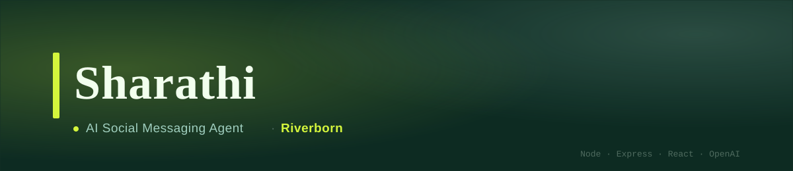
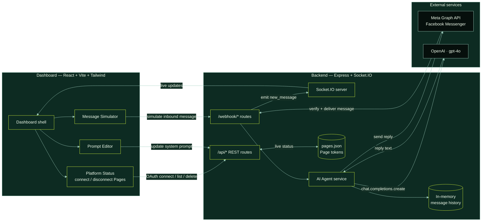
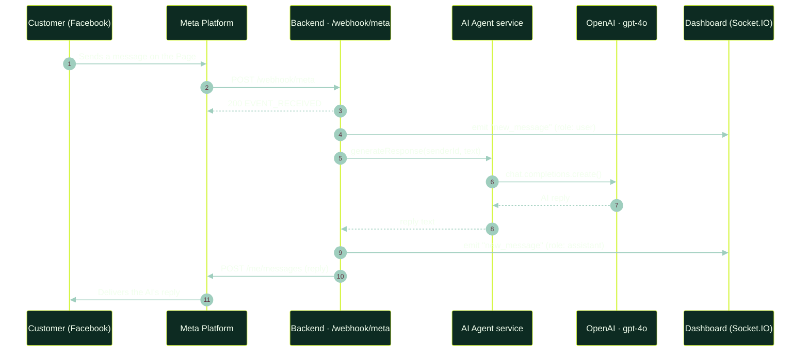

<div align="center">



<br/>


</div>

<br/>

## What this is

**Sharathi** is a small full-stack AI agent that answers messages on a business's social inbox — currently **Facebook Messenger**, via the Meta Graph API — and gives the team a live dashboard to watch, connect pages, and tune the agent's behavior without touching code.

A message arrives on a connected Facebook Page → Meta calls the backend webhook → the message is handed to an OpenAI (`gpt-4o`) agent with the last 10 turns of conversation memory → the reply is sent straight back to the customer on Facebook → and the whole exchange is streamed live to the dashboard over Socket.IO.

It ships as an npm workspaces monorepo: an **Express + Socket.IO** backend and a **React + Vite + Tailwind** frontend, built to run together as a single deployable service.

<br/>

## Features

- **Live dashboard** — every inbound/outbound message across every connected platform streams into the UI in real time over Socket.IO.
- **Facebook Messenger integration** — full OAuth 2.0 page-connect flow, Meta webhook verification, inbound message handling, and outbound replies via the Send API.
- **Multi-page support** — connect and manage several Facebook Pages dynamically (tokens persisted to `backend/data/pages.json`), with a static `PAGE_ACCESS_TOKEN` as a single-page fallback.
- **AI replies with memory** — OpenAI `gpt-4o` generates responses using a rolling, per-user window of the last 10 messages.
- **Live prompt editor** — the agent's system prompt can be rewritten from the dashboard, no redeploy needed (backend restart required to pick it up — see [Known limitations](#known-limitations)).
- **Webhook simulator** — fire a fake Facebook message at the agent straight from the UI, useful for testing without a real Page.
- **One-shot GCP deploy** — `deploy_gcp.sh` provisions a static IP, an `e2-micro` VM, Nginx, and PM2, and redeploys on every re-run.

<br/>

## Architecture



**How the pieces fit together:**

The **frontend** is a single-page React app (`frontend/`) served as a static build by the backend in production, or via Vite's dev server (proxying `/api`, `/webhook`, and `/socket.io` to the backend) during development. It has three panels: connection/status management for Facebook Pages, a simulator for sending test webhook messages, and an editor for the agent's system prompt.

The **backend** (`backend/`) is a single Express app that does four jobs: serves the REST API the dashboard talks to, receives Meta's webhook calls, generates AI replies, and pushes every message through Socket.IO so the dashboard updates live. State is intentionally lightweight — conversation history lives in an in-memory `Map` (capped at 10 messages per user, cleared on restart) and connected Facebook Pages persist to a flat JSON file (`backend/data/pages.json`) rather than a database.

<br/>

## Message flow (sequence)



<br/>

## Project structure

```
Sharathi/
├── backend/
│   ├── data/                     # pages.json — dynamically connected FB Pages + tokens
│   ├── src/
│   │   ├── index.js              # Express + Socket.IO entrypoint, serves frontend/dist in prod
│   │   ├── prompts/
│   │   │   └── systemPrompt.js   # Current AI system prompt (editable via the dashboard)
│   │   ├── routes/
│   │   │   ├── chat.js           # POST /api/chat — talk to the agent directly
│   │   │   ├── messages.js       # GET  /api/messages/:userId/history
│   │   │   ├── platforms.js      # Facebook OAuth flow + page management
│   │   │   ├── settings.js       # POST /api/settings/prompt
│   │   │   └── webhooks.js       # /webhook/meta, /webhook/incoming
│   │   └── services/
│   │       ├── aiAgent.js        # OpenAI chat-completion wrapper + logging
│   │       ├── messageStore.js   # In-memory rolling conversation history (per user)
│   │       ├── pageStore.js      # JSON-backed Facebook Page token store
│   │       └── platforms/
│   │           └── facebook.js   # Facebook Send API integration
│   ├── .env.example
│   └── package.json
├── frontend/
│   ├── src/
│   │   ├── App.jsx                  # App shell + Facebook OAuth callback handling
│   │   ├── main.jsx
│   │   ├── index.css
│   │   └── components/
│   │       ├── Dashboard.jsx        # Layout for the three dashboard panels
│   │       ├── PlatformStatus.jsx   # Connect/monitor Pages, OAuth redirect URI validator
│   │       ├── MessageSimulator.jsx # Fire a test webhook message at the agent
│   │       └── PromptEditor.jsx     # Live-edit the agent's system prompt
│   ├── index.html
│   ├── tailwind.config.js
│   ├── vite.config.js
│   └── package.json
├── deploy_gcp.sh                 # One-shot GCP VM provisioning + redeploy script
├── package.json                  # npm workspaces root (concurrently dev runner)
└── README.md
```

<br/>

## Getting started

**Prerequisites:** Node.js 18+, an OpenAI API key, and — for real Facebook integration — a Meta App with Messenger permissions plus a public HTTPS URL (e.g. [ngrok](https://ngrok.com), already whitelisted in `frontend/vite.config.js`) to receive webhooks.

**1. Install dependencies** (root `package.json` declares `backend` and `frontend` as npm workspaces):

```bash
git clone <this-repo-url>
cd Sharathi
npm install
```

**2. Configure environment variables** — copy `backend/.env.example` to `backend/.env` and fill it in:

| Variable | Required | Description |
|---|---|---|
| `PORT` | No — defaults to `3000` | Backend server port |
| `OPENAI_API_KEY` | **Yes** | Used by `backend/src/services/aiAgent.js` to call `gpt-4o` |
| `META_APP_ID` | For Facebook OAuth | Meta App ID for the "Connect Page" login flow |
| `META_APP_SECRET` | For Facebook OAuth | Meta App Secret |
| `META_VERIFY_TOKEN` | For webhook verification | Must match the token entered in the Meta App Dashboard's webhook config |
| `META_REDIRECT_URI` | No | Overrides the OAuth redirect URI (defaults to `<host>/facebook-callback`) |
| `PAGE_ACCESS_TOKEN` | No | Static fallback token used when no Page has been connected dynamically |

> **Note:** `backend/.env.example` currently lists `ANTHROPIC_API_KEY`, but the AI Agent service reads `OPENAI_API_KEY` at runtime — set `OPENAI_API_KEY` in your `.env`, not the Anthropic one.

**3. Run in development:**

```bash
npm run dev
```

This runs the backend (`nodemon`) and frontend (`vite`) concurrently. The Vite dev server proxies `/api`, `/webhook`, and `/socket.io` to the backend on **port 3001** — set `PORT=3001` in `backend/.env` for local development, or the proxy target in `frontend/vite.config.js`, so the two agree (see [Known limitations](#known-limitations)).

**4. Build & run for production:**

```bash
npm run build   # builds frontend → frontend/dist
npm start        # backend serves the API, webhooks, and the built frontend as an SPA
```

<br/>

## API reference

| Method | Endpoint | Description |
|---|---|---|
| `POST` | `/api/chat` | Send a message directly to the AI agent (bypasses any platform); broadcasts to the dashboard |
| `GET` | `/api/messages/:userId/history` | Fetch a user's stored conversation history |
| `GET` | `/api/platforms/status` | Platform connection status + list of connected Facebook Pages |
| `GET` | `/api/platforms/facebook/auth` | Starts the Facebook OAuth login/connect flow |
| `POST` | `/api/platforms/facebook/callback` | Exchanges the OAuth code, stores Page tokens, subscribes webhooks |
| `GET` | `/api/platforms/facebook/pages` | Lists connected Facebook Pages |
| `DELETE` | `/api/platforms/facebook/pages/:pageId` | Disconnects a Facebook Page |
| `POST` | `/api/settings/prompt` | Overwrites `systemPrompt.js` with a new prompt (requires backend restart) |
| `GET` | `/webhook/meta` | Meta webhook verification handshake |
| `POST` | `/webhook/meta` | Receives live incoming Messenger events |
| `POST` | `/webhook/incoming` | Generic simulate/test endpoint used by the Message Simulator panel |

The server also emits a single Socket.IO event, **`new_message`**, with `{ platform, senderId, text, role }`, for every user and assistant message.

<br/>

## Deployment

`deploy_gcp.sh` is a repeatable, idempotent deploy script for a Google Cloud VM: it reserves a static IP, provisions an `e2-micro` instance in `asia-south1` (Debian 11) with Node 20, Nginx, and PM2 on first run, then on every run it archives the project, ships it to the VM, installs backend dependencies, and restarts the process under PM2. Nginx reverse-proxies port `80` to the app on port `3000`.

```bash
gcloud config set project YOUR_PROJECT_ID
./deploy_gcp.sh
```

> The archive step excludes the `frontend/` directory entirely — build the frontend and adjust the script (or ship `frontend/dist` separately) before relying on this for a UI deploy; see [Known limitations](#known-limitations).

<br/>

## Known limitations

A few things worth knowing before you dig in — noted here rather than silently worked around:

- **Env var name mismatch** — `backend/.env.example` references `ANTHROPIC_API_KEY`, but the code (`aiAgent.js`) reads `OPENAI_API_KEY`.
- **Dev port mismatch** — the backend defaults to port `3000`, but `frontend/vite.config.js` proxies to `3001`; set `PORT=3001` in `backend/.env` (or update the proxy) for `npm run dev` to work out of the box.
- **`deploy_gcp.sh` excludes `frontend/`** from the deployment archive, so a plain run of the script won't ship the dashboard UI to the VM.
- **In-memory conversation history** resets on every backend restart; there's no database in this stack.
- **`backend/data/pages.json` stores Facebook Page access tokens in plaintext** on disk — keep it out of version control and treat it as a secret.
- **Prompt edits from the dashboard require a manual backend restart** to take effect (the editor writes to `systemPrompt.js`, which is `require`'d once at boot).

<br/>

## Tech stack

| Layer | Stack |
|---|---|
| Frontend | React 18, Vite 5, Tailwind CSS 3, Socket.IO client |
| Backend | Node.js, Express 5, Socket.IO, Axios, dotenv |
| AI | OpenAI (`gpt-4o`) |
| Messaging | Meta Graph API (Facebook Messenger — OAuth, webhooks, Send API) |
| Storage | In-memory (conversation history), flat JSON file (Page tokens) |
| Deployment | Google Cloud Compute Engine, Nginx, PM2 |

<br/>

<div align="center">

Built by <strong style="color:#D4F53C">Riverborn</strong>

</div>
